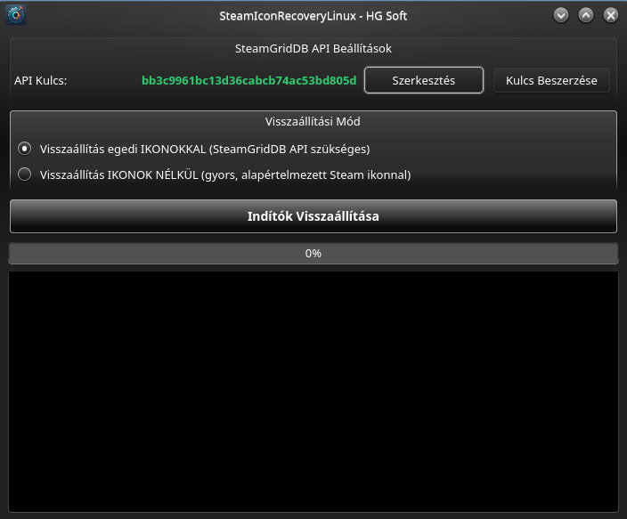

# SteamIconRecoveryLinux (HG Soft)

A **SteamIconRecoveryLinux** egy hordozható, felhasználóbarát Python/PySide6 alapú Linux segédprogram (kifejezetten KDE Plasma környezethez), amely automatikusan helyreállítja a hiányzó Steam játékindítókat és letölti hozzájuk a hivatalos, nagyfelbontású ikonsorozatokat a **SteamGridDB API** segítségével.

<p align="center">
  
</p>
---

## 🌟 Főbb jellemzők

- **Automatikus könyvtárdetektálás:** Megkeresi a rendszeren létező összes Steam könyvtárat (beleértve a Flatpak, az egyéni meghajtók és a másodlagos könyvtárak könyvtárait is).
- **SteamGridDB API integráció:** Kiváló minőségű, hivatalos négyzetes (256x256) PNG ikonokat szerez be a játékok AppID-ja alapján.
- **Rugalmas üzemmódok:**
  - **Ikonokkal történő visszaállítás:** SteamGridDB API kulcs használatával.
  - **Ikonok nélküli visszaállítás:** Gyors indítógenerálás az alapértelmezett Steam ikonnal (API kulcs nem szükséges).
- **KDE Plasma optimálás:** Automatizált `kbuildsycoca` és ikon-cache frissítés a menübejegyzések azonnali megjelenítéséhez.
- **Biztonságos konfigurációkezelés:** Az API kulcsot a `~/.config/hgsoft/SteamIconRecoveryLinux.conf` fájlban tárolja elkülönítve, a kód módosítása nélkül.
- **Intelligens UI:** Megjegyzi az elmentett API kulcsot, a kulcs megléte esetén kihagyja az indítási tájékoztatót, és lehetőséget ad a kulcs névtelen megjelenítésére/szerkesztésére.
- **Részletes statisztikai összesítés:** A folyamat végén pontos elszámolást ad az újonnan letöltött, a már meglévő, és a hiányzó ikonokról.

---

## 📦 Függőségek

A szoftver futtatásához az alábbi Python csomagokra és rendszerszintű eszközökre van szükség:

- Python 3.8+
- PySide6 (Qt GUI felület)
- Pillow (PIL – ikonkonvertáláshoz)
- curl (letöltésekhez)

Telepítés Arch / Manjaro / Nobara / Fedora rendszereken:

    pip install PySide6 Pillow

---

## 🚀 Telepítés

### A) Előre csomagolt verzió letöltése (Ajánlott)

1. Töltsd le a legfrissebb `SteamIconRecoveryLinux-v1.0.tar.gz` csomagot a [Releases](../../releases) oldalról.
2. Csomagold ki és futtasd a telepítőt:


```bash
tar -xzf SteamIconRecoveryLinux-v1.0.tar.gz
cd SteamIconRecoveryLinux
chmod +x installer.sh
./installer.sh
```

---

### B) Klónozás forráskódból

    git clone https://github.com/felhasznalonev/SteamIconRecoveryLinux.git
    cd SteamIconRecoveryLinux
    chmod +x installer.sh
    ./installer.sh
    
---

## 🛠️ Használat

A program indítható:
1. A KDE alkalmazásmenüből (**Játékok** / **Segédprogramok** almenü).
2. Terminálból a következő paranccsal:

    steamiconrecovery

### API kulcs beszerzése
Az ikonok letöltéséhez ingyenes SteamGridDB API kulcsra van szükség:
1. Lépj be a [SteamGridDB API fiókodba](https://www.steamgriddb.com/profile/preferences/api).
2. Generálj egy kulcsot, majd másold be az alkalmazás felületén.
3. Kattints a **Mentés** gombra (a kulcs elmentődik, és a felület letisztult nézetre vált).

---

## 🗑️ Eltávolítás

Ha el szeretnéd távolítani az alkalmazást és az összes hozzá tartozó konfigurációt:

    chmod +x uninstall.sh
    ./uninstall.sh

---

## 📦 Build / Csomagolás

A terjeszthető `.tar.gz` csomag előállításához futtasd a build szkriptet:

    chmod +x build.sh
    ./build.sh

---

## 📜 Licenc & Fejlesztő

- **Fejlesztő:** HG Soft
- **Platform:** Linux (KDE Plasma)
- **Licenc:** [GNU General Public License v3.0 (GPLv3)](LICENSE)
